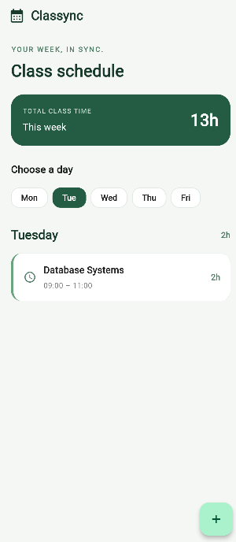
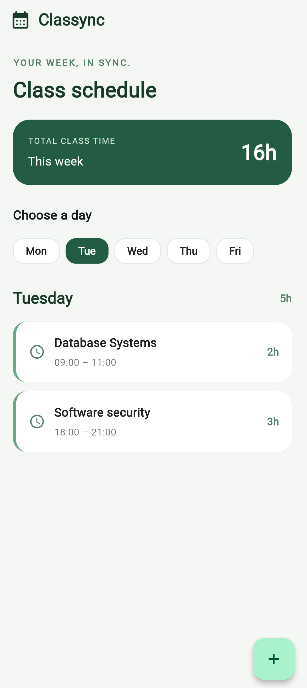
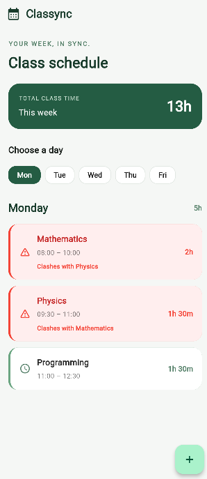
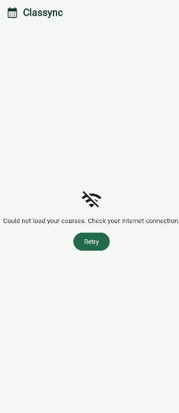

# Classync

Classync is a weekly class schedule app that sorts my courses, adds up my hours and warns me when two courses clash.

My data is now saved on the phone with shared_preferences, so nothing is lost when the app closes, and it shows my course list from a courses.json file hosted on GitHub (raw.githubusercontent.com) as its API.

## Screenshots

## Think

1. **Clash condition in plain words:** two courses on the same day clash if each one starts before the other ends. I use `<` and not `<=` because a course ending at 11:00 and one starting at 11:00 only touch at one moment and share no minutes, so they do not clash.
2. **Why minutes instead of text:** minutes are whole numbers, so comparing, sorting and subtracting are one line each. With text like `08:30` I would have to split and convert every time, and comparing text like `9:00` and `10:00` gives the wrong order.
