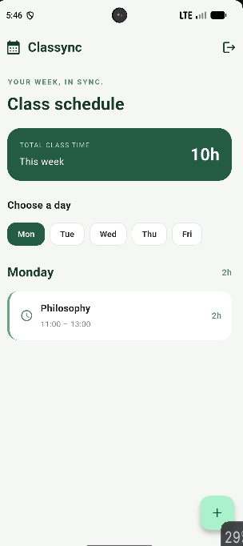
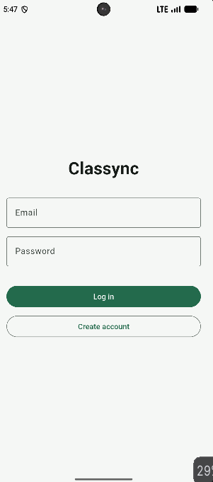
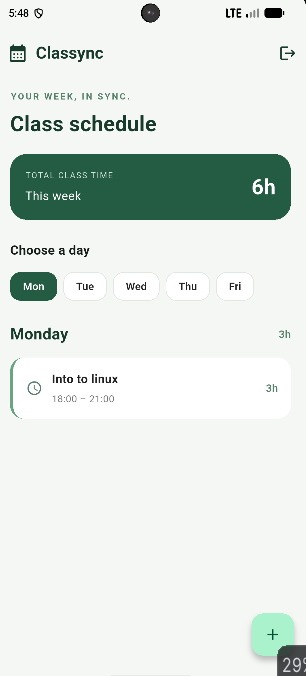
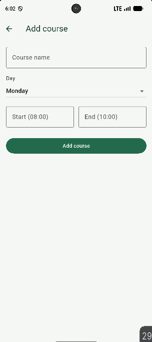
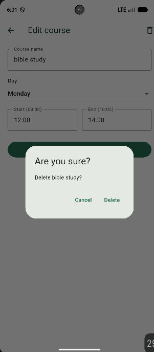
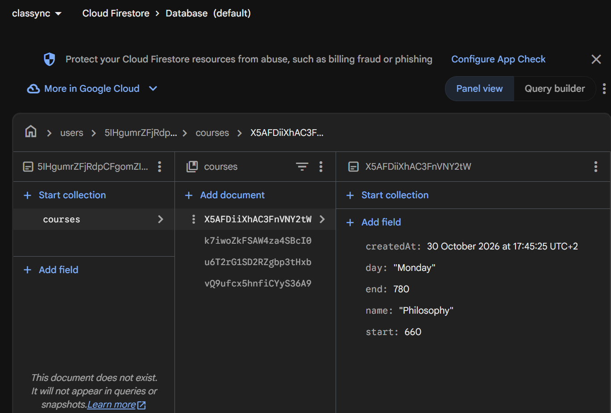
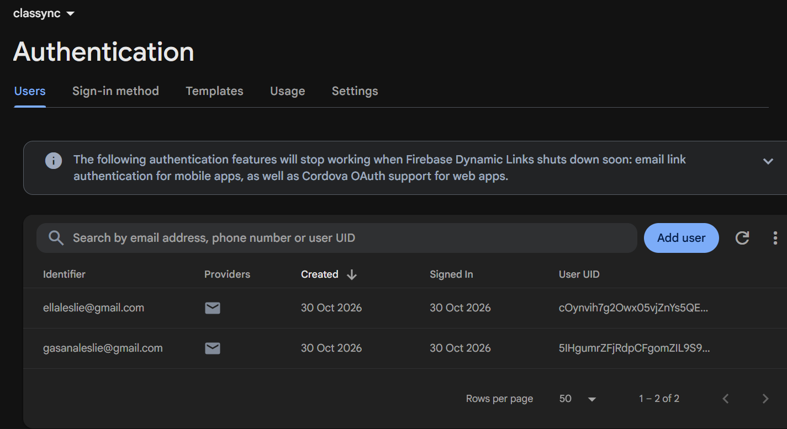

# Classync (My Week)

**Author:** Akariza GASANA Leslie  (27413)

A weekly class schedule app built with Flutter: pick a day, see its courses sorted by start time, the day and week totals, and a red warning when two courses clash.

Courses are saved in Firebase Firestore under each user's own account, and people log in with email and password. Nobody can read another user's courses.

## What I built

1. **Firebase project:** Email/Password sign-in turned on, a Firestore database in production mode, and security rules so each user can only read and write `users/{their id}/...`.
2. **Connected the app:** `firebase_core`, `firebase_auth` and `cloud_firestore`, with `google-services.json` and `Firebase.initializeApp()`.
3. **Login screen:** log in or create an account, with clear messages for a wrong email, a short password, a wrong password or no internet.
4. **Auth gate and log out:** the app opens on the login screen, or on the schedule when someone is logged in. The log-out button is in the app bar.
5. **Courses in Firestore:** each course is saved in `users/{uid}/courses` with `name`, `day`, `start` and `end` (minutes). Totals and clashes are calculated, never saved. A new account gets 7 sample courses.
6. **Live list:** a `StreamBuilder` shows the courses, with loading, error and empty states. A change in Firestore appears in the app by itself.
7. **Add, edit and delete:** tap a course to edit it, use + to add one, and the bin icon to delete it after an "Are you sure?" question. Every change goes to Firestore.
8. **Private data:** I logged in with two accounts, and each one sees only its own courses.

## Screenshots

Account 1 has its own course:

Login screen after logging out:

Account 2 has different data:

Add a course, and delete one after "Are you sure?":

The data lives in Firestore, under `users/{uid}/courses`:

Two accounts in Firebase Authentication:

## Think

1. **Clash condition in plain words:** two courses on the same day clash if each one starts before the other ends (`aStart < bEnd && bStart < aEnd`). With `<` and not `<=`, a course ending at 11:00 and one starting at 11:00 do not clash, because they only touch at one moment and share no minutes. With `<=` they would wrongly turn red.
2. **Why minutes instead of text:** minutes are whole numbers, so comparing, sorting and subtracting are one line each (`end - start`). With text like `08:30` I would have to split and convert every time, and comparing text like `'9:00'` and `'10:00'` gives the wrong order.